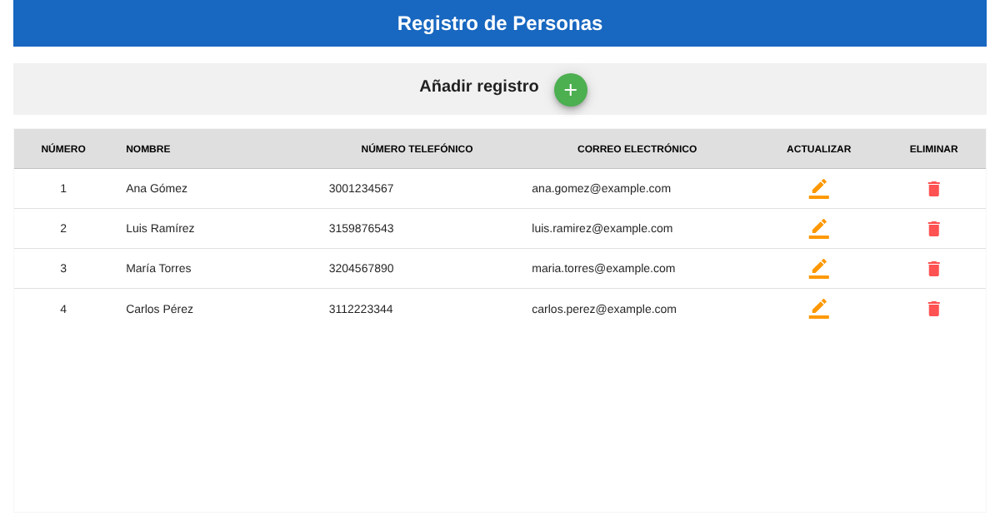
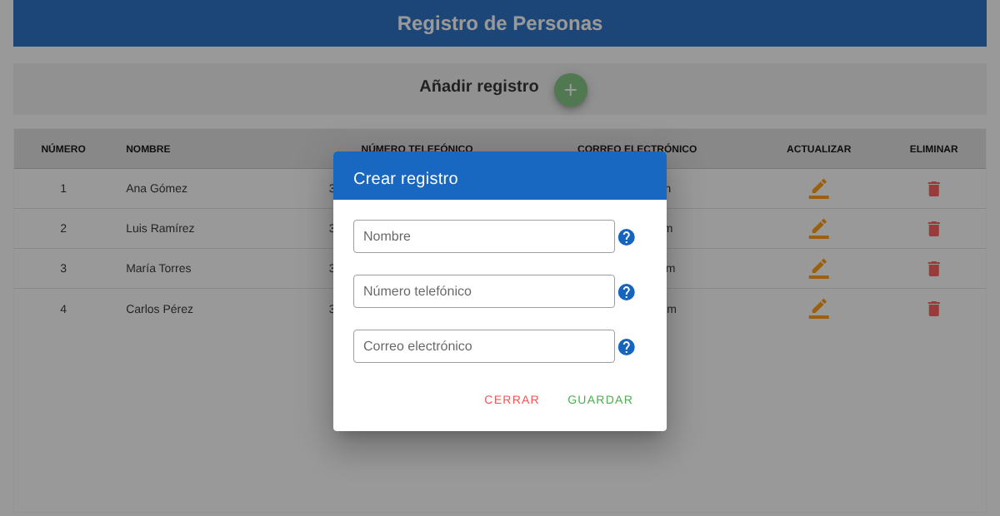

# person-crud-vue

[](https://github.com/JohnDavidV/person-crud-vue/actions/workflows/ci.yml)

Single-page app to create, list, edit and delete people (name, phone and email), built with **Vue 2, Vuetify and Axios**. It talks to the REST API in [person-crud-api-spring-boot](https://github.com/JohnDavidV/person-crud-api-spring-boot).

One of my first frontend projects (2023). The UI is in Spanish.





## Features

- Data table with all the records and edit and delete actions per row.
- Dialog form reused for creating and updating.
- Phone field that only accepts digits.
- Backend URL configurable with an environment variable.

## Running it

Start the API first (see [person-crud-api-spring-boot](https://github.com/JohnDavidV/person-crud-api-spring-boot)), then:

```bash
npm install
npm run serve        # http://localhost:8080 is taken by the API, Vue picks the next free port
```

By default the app calls `http://localhost:8080`. To point it somewhere else, copy `.env.example` to `.env.local` and change:

```
VUE_APP_API_URL=http://localhost:8080
```

Production build:

```bash
npm run build
```

## Tech

Vue 2, Vuetify 2, Axios, Vue CLI 5, ESLint.
